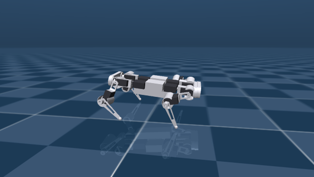
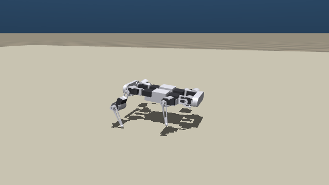

# medo-sim

A lightweight "Isaac Sim, but it fits on your machine" trainer for **Medo**,
a small 3D-printed quadruped robot. MuJoCo physics + parallel environments +
a from-scratch PPO implementation, all local — no 30 GB Omniverse install.
The whole stack is well under 1 GB and trains a walking policy on a Ryzen
5600 in hours, not days.

<p>
  
  
</p>

Medo's body is modeled from a real Fusion 360 CAD export (URDF + meshes),
down to honest servo torque limits and printed-part masses — not a toy
capsule quadruped. The goal is a policy that transfers to the physical
robot, not just a simulator demo.

## Quickstart

```bash
python -m venv .venv
.venv\Scripts\activate          # .venv/bin/activate on Linux/macOS
pip install -r requirements.txt

python view.py                                              # look at Medo, no policy
python play.py policies\medo_walk_v3.pt --cmd 0.4 0 0        # watch it walk, keyboard-steerable
python eval.py policies\medo_walk_v3.pt --probes straight    # measure tracking/drift
python train.py --run-name my_run --deploy --gait-clock --straight   # train your own
```

Requires MuJoCo 3.1+, PyTorch, and NumPy. GPU is optional — see
[GPU training](#gpu-training) below.

## What's in the repo

```
assets/medo_real.xml         the real Medo (built from the Fusion 360 export) — the default model
assets/robot_dog_description Fusion 360 export: URDF + STL meshes
assets/medo.xml              placeholder capsule quadruped kept for comparison
medo_sim/env.py              locomotion task: velocity commands, rewards, domain randomization
medo_sim/terrain.py          procedural terrain: rough ground, slopes, stair pyramids
medo_sim/vec_env.py          N parallel envs on threads (MuJoCo releases the GIL)
medo_sim/ppo.py              PPO from scratch: adaptive-KL learning rate, obs normalization
train.py                     training loop -> runs/<name>/ckpt_*.pt + log.csv
play.py                      drive a trained policy with the keyboard in the interactive viewer
eval.py                      pass/fail harness: does it walk fwd/back/left/right, how straight?
view.py                      inspect any model, no policy needed
tools/build_medo_real.py     rebuilds medo_real.xml from the Fusion export
tools/convert_model.py       generic Fusion 360 URDF -> MJCF converter
tools/bc_warmstart.py        behavior-clone a scripted trot as a PPO warm start
tools/bc_stairs.py           behavior-clone a high-step gait for stair climbing
deploy/                      bridge to the physical robot: ESP32-S3 firmware + host runner
docs/EXPORT_GUIDE.md         how the Fusion 360 -> sim pipeline works, for re-exports
tests/                       smoke tests for the env, vec env, and PPO update step
policies/                    trained checkpoints, see below
```

## Policies

| File | What it does |
|---|---|
| `medo_walk_v4.pt` | **Current best, all-terrain.** Walks flat ground straight (worst tracking error 0.11, ~3 cm/m drift), climbs 14° slopes cleanly, crosses rough rubble tiles. Stair climbing is a known weak point — see [Known limitations](#known-limitations). |
| `medo_walk_v3.pt` | **Flat-ground specialist.** The straightest, cleanest walk in the repo: 0.7–4.6 cm/m lateral drift, well under 1°/m heading drift, zero falls over long runs. No terrain, no strafing — pure forward/backward precision. |
| `medo_walk_v2.pt`, `medo_walk_v1.pt` | Earlier checkpoints, kept for comparison. v1 is omnidirectional (walks/strafes/turns) but veers into circles — it predates the heading-error observation that fixed that. |
| `medo_walk_fastest.pt`, `medo_walk10_early.pt` | Snapshots from an earlier training run, kept as reference points. |

All deploy-layout policies (`--deploy` trained) use only observations the
real robot can actually measure — no ground-truth linear velocity, which a
physical IMU can't provide. `layout_for_n_obs()` in `medo_sim/env.py`
auto-detects a checkpoint's observation layout, so `play.py` / `eval.py` /
`deploy/run_policy.py` all load any policy without extra flags.

```bash
python play.py policies\medo_walk_v4.pt --terrain --kind slope --difficulty 0.6 --cmd 0.4 0 0
python play.py policies\medo_walk_v4.pt --terrain --kind stairs --difficulty 0.2 --cmd 0.3 0 0
python play.py policies\medo_walk_v3.pt --cmd 0.4 0 0
```

Training prints one line per iteration; `ret` (mean episode return) and
`len` (mean episode length, capped at 1000) are the health signals to
watch — expect `len` to climb first, then `ret`. A decent flat-ground gait
typically appears in the 10–30M step range (a few hours on a Ryzen 5600;
throughput rises over time as the policy stops falling and resets get
rarer).

## The real Medo model

`assets/medo_real.xml` is built from the Fusion 360 export in
`assets/robot_dog_description` by `tools/build_medo_real.py`. The export's
joint axes sit on the real MG996 servo shafts (verified against the meshes
to ~1 mm), but its masses were Fusion "Steel" placeholders (8 kg!), so the
builder recomputes inertia from the meshes instead: printed parts at an
effective PLA density, 55 g per servo, plus a 220 g battery/electronics
block — 1.55 kg total. Servos are modeled honestly (1.3 Nm torque cap,
MG996-like speed limit). Collision uses hidden primitives fitted to the
meshes; only the toe spheres are meant to touch the ground.

Numbers worth verifying against the physical dog (then edit the constants
at the top of `tools/build_medo_real.py` and rerun it):

- **total mass** — weigh the dog, tweak `PLA_EFF` / `BATTERY_MASS`
- **servo torque** — `SERVO_TORQUE` (MG996R at 5–6 V is roughly 1.0–1.3 Nm)
- **which end is the head** — the builder trusts the export's fr/br labels;
  if forward comes out mirrored, that's a sign flip, not a retrain

If you re-export from Fusion, drop the new package into
`assets/robot_dog_description` and rerun the builder — see
`docs/EXPORT_GUIDE.md` for the full Fusion -> MJCF pipeline.

Everything defaults to the real Medo (`assets/medo_real.xml`); pass
`--model assets/medo.xml` to any script for the old placeholder quadruped.

## Terrain training

`medo_sim/terrain.py` generates a fresh world every episode: rough ground
(random-height tiles), slopes (an exact tilted plane), and stair pyramids
climbing away from a level spawn disc — all built from box primitives for
exact, analytic collision (an earlier heightfield-based version let feet
visibly sink into bumps and slopes; see
[Known limitations](#known-limitations) for the harder lesson this
surfaced). Difficulty is **per terrain kind** and adapts automatically: it
rises when an episode banks real forward progress, and backs off on a
fall, so training always sits near the frontier of what the policy can
actually do.

```bash
python train.py --run-name my_terrain_run --deploy --gait-clock --straight --terrain
python play.py policies\medo_walk_v4.pt --terrain --kind rough --difficulty 0.5 --cmd 0.4 0 0
```

`--kind {rough,slope,stairs}` pins one terrain type in the viewer instead
of rolling randomly; `--difficulty 0..1` sets how hard.

## Known limitations

**Stair climbing is unsolved.** `medo_walk_v4.pt` ascends stairs
haltingly and falls more often than not above ~3.5 cm risers, even though
it descends them fine and handles comparably steep slopes well. The
project's memory notes (`docs/EXPORT_GUIDE.md` and training logs) record a
chain of real bugs found and fixed along the way — a reward-curriculum
loophole that let the policy "pass" stair training by flanking around the
staircase on flat ground, and, more seriously, a MuJoCo collision-caching
issue where terrain boxes repositioned at runtime weren't recognized by
the physics engine's broad-phase collision check, so the robot was
briefly walking *through* solid-looking stairs during part of training.
Both are fixed (verified with drop tests, not just visuals), and the
curriculum, reward shaping, and a behavior-cloned high-step gait are all
in place — what's missing is simply more training time on the corrected
physics. If you pick this up: start from `medo_walk_v4.pt` with
`train.py --terrain`, and consider an ascent-only stair curriculum or a
height-gain-based success metric rather than distance-based.

## Knobs that matter

- `EnvConfig` in `medo_sim/env.py` — command ranges, reward scales, domain
  randomization, terrain settings. The reward structure is
  legged-gym-style: if the gait is jittery, strengthen `rew_action_rate`;
  if it drags its feet, raise `rew_air_time`; `--straight` trades
  omnidirectional coverage for a heading-error observation and a
  world-frame progress reward that actively punishes drift.
- `--num-envs` — default 12 parallel threads. More helps until the CPU
  saturates; watch out for host memory when combined with other
  memory-heavy processes.
- `PPOConfig` in `medo_sim/ppo.py` — network sizes, KL target, entropy
  coefficient. `max_log_std` hard-caps exploration noise — PPO's entropy
  bonus will otherwise slowly inflate it until a trained gait erodes back
  into noise; this was a repeat failure mode worth guarding against if you
  fork the training loop.

## GPU training

`train.py` picks a visible GPU automatically (`--device cpu` forces CPU).
Training is deliberately hybrid: rollout inference runs on a CPU copy of
the policy (at small batch sizes the GPU transfer latency costs more than
it saves), while PPO updates ship the whole batch to the GPU once per
iteration. Install the CUDA build of torch for this; the CPU-only build
works fine too, just slower on the update step.

## Deploying to the physical robot

`deploy/` has a serial bridge protocol for an ESP32-S3 + PCA9685 servo
driver setup, a servo channel/direction/trim mapping, and a host-side
runner. See `deploy/README.md` for the calibration procedure — bridge
flashing, stance verification, and the two things real closed-loop walking
still needs (an IMU on the robot, and a policy trained with
`--deploy` so it never expects ground-truth velocity).

## Tests

```bash
python -m pytest tests -q
```

Smoke tests for environment reset/step validity, the threaded vec-env
wrapper, and one PPO update step.

## License

MIT — see [LICENSE](LICENSE).
